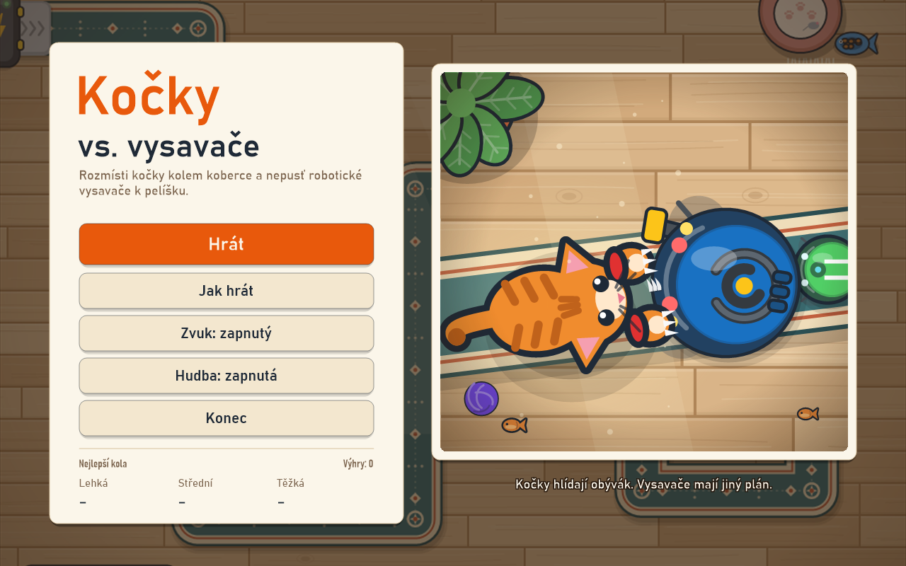
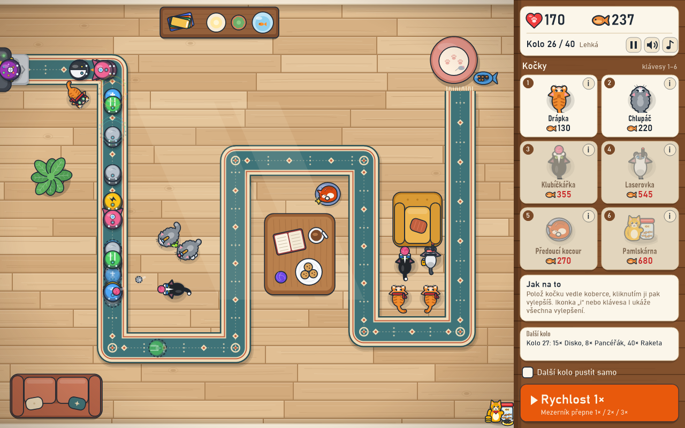
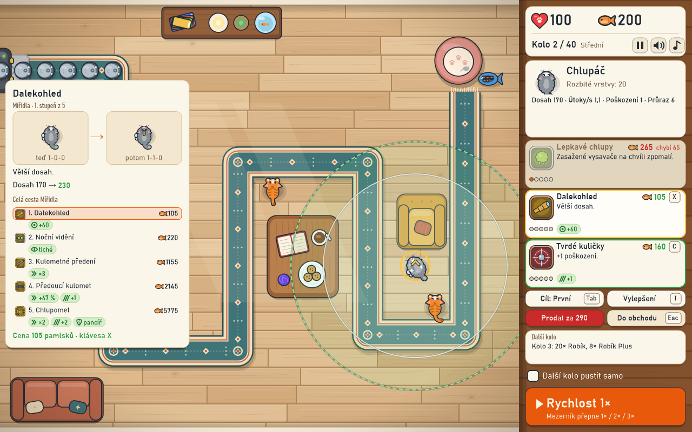
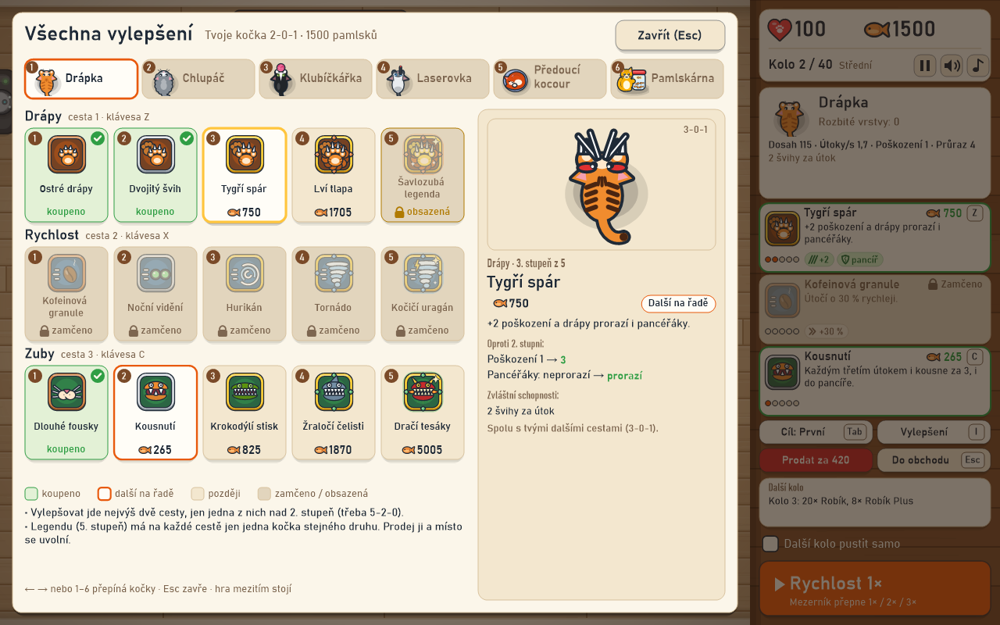

# Kočky vs. vysavače

Tower defense pro Windows s vlastním kresleným vzhledem, hudbou a zvuky. Z nabíječky vlevo vyjíždějí po koberci robotické vysavače a jedou k pelíšku vpravo nahoře. Každý, který tam dojede, ti vezme životy. Ty rozmísťuješ po obýváku kočky (šest druhů s různými schopnostmi, útočící mají vlastní dosah) a za pamlsky, které dostáváš za rozbité vrstvy vysavačů, je vylepšuješ. Každá kočka má tři cesty vylepšení po pěti stupních, ale vylepšovat jde nejvýš dvě cesty a jen jedna z nich nad druhý stupeň. Hra má 40 kol, tři obtížnosti, tiché a pancéřované vysavače, dva obří bossy a po 40. kole volnou hru, která je čím dál těžší. Celá hra je česky a žádné obrázky ani zvuky se nenačítají ze souborů: všechno se kreslí a syntetizuje přímo v programu.



## Snímky obrazovky

Snímky vyrobil sám program přepínačem `--shots` (viz [docs/TESTY.md](docs/TESTY.md)). Scény jsou připravené programem, část z nich (například počet pamlsků) je nastavená uměle, takže nejde o záznam ručního hraní.



Hra ve 26. kole na Lehké obtížnosti. Vpravo je obchod se šesti kočkami a náhled dalšího kola.



Vybraná kočka (Chlupáč) s kruhem dosahu, tři cesty vylepšení vpravo a bublina s celou cestou Mířidla.



Okno všech vylepšení (klávesa `I`): tři cesty po pěti stupních, stav každého stupně, náhled kočky a čísla před a po vylepšení. Hra při jeho otevření stojí.

## Ovládání

Texty vychází z obrazovky „Jak hrát“ přímo ve hře (`zdrojaky\Ui.cs`).

| Vstup | Co dělá |
|---|---|
| Levé tlačítko myši | vybere kočku v obchodě a položí ji na podlahu; kliknutím na kočku na podlaze ji vybereš, kliknutím na prázdné místo výběr zrušíš |
| `Shift` + klik | po položení můžeš hned pokládat další stejnou kočku |
| Pravé tlačítko myši | zruší pokládání nebo výběr (v okně vylepšení ho zavře) |
| `1` až `6` | vybere kočku z obchodu |
| `Mezerník` | pustí kolo; během kola přepíná rychlost 1× / 2× / 3× |
| `Z` `X` `C` (nebo `,` `.` `-`) | vylepší cestu 1 / 2 / 3 vybrané kočky |
| `I` | otevře okno všech vylepšení (v něm `←` `→` nebo `1` až `6` přepínají druhy koček, `Esc` nebo `I` ho zavře) |
| `Tab` | přepne, na koho kočka míří: první / poslední / nejsilnější / nejbližší |
| `Delete` | dvakrát za sebou prodá vybranou kočku |
| `Esc` | zruší pokládání, zavře výběr, jinak zapne pauzu (v pauze ji vypne) |
| `P` | pauza |
| `M` / `N` | zapne a vypne zvuk / hudbu |

Na úvodní obrazovce otevře výběr obtížnosti `Enter` nebo `Mezerník`, obtížnost pak vybereš klávesami `1`, `2`, `3` (Lehká, Střední, Těžká) a `Esc` vrací zpět. V pravém panelu je zaškrtávátko „Další kolo pustit samo“ a velké tlačítko „Pustit vysavače“.

## Spuštění

Potřebuješ 64bitové Windows 10 nebo 11 (obsahují .NET Framework a překladač `csc.exe`). Nic se neinstaluje ani nestahuje.

### A) Hotové exe

1. Rozbal složku (pokud ji máš v zipu).
2. Spusť `dist\KockyVsVysavace.exe` dvojklikem.
3. Exe není digitálně podepsané, proto může Windows SmartScreen ukázat okno „Systém Windows ochránil váš počítač“. Klikni na **Další informace** a pak na **Přesto spustit**.

### B) Sestavení ze zdrojů

V kořenové složce projektu spusť:

```
powershell -ExecutionPolicy Bypass -File zdrojaky\build.ps1
```

Skript přeloží všechny soubory `zdrojaky\*.cs` překladačem `csc.exe` z Windows (trvá několik sekund) a vznikne `zdrojaky\KockyVsVysavace.exe`. Překlad má dva průchody: první vytvoří exe, to si samo nakreslí ikonu (`zdrojaky\app.ico`) a druhý průchod ji do exe vloží. Výsledné exe i `app.ico` jsou v `.gitignore`, hotová hra v repozitáři je jen v `dist\`.

### C) Testy

```
powershell -ExecutionPolicy Bypass -File tests\run-tests.ps1
```

Skript zkopíruje zdrojáky do dočasné složky, přeloží je, pustí simulaci bota, vykreslení všech obrazovek a test, při kterém se hra v otevřeném okně sama ovládá klikáním a klávesami, a vypíše PASS nebo FAIL za každý krok. Celé to trvá asi 2 až 3 minuty. Přepínač `-SkipUi` vynechá test s oknem. Popis testů, ruční testovací scénář a výsledky jsou v [docs/TESTY.md](docs/TESTY.md).

### Přepínače programu

Obyčejné spuštění otevře hru. Pro testování a přípravu podkladů umí exe i tyto přepínače:

| Přepínač | Co dělá |
|---|---|
| `--sim N [soubor]` | bot zahraje N her na každé obtížnosti a ve volné hře, bez okna; zapíše textový report |
| `--uitest N [soubor]` | otevře okno, samo v něm odehraje N her klikáním a klávesami a zapíše report |
| `--shots složka` | vykreslí klíčové obrazovky do PNG |
| `--audio složka` | uloží všechny zvuky a hudební smyčku jako WAV |
| `--icon soubor.ico` | uloží ikonu aplikace |

Hra si ukládá nastavení zvuku, hudby a nejlepší kola do `%APPDATA%\KockyVsVysavace\nastaveni.txt`. Když se zhroutí, zapíše podrobnosti do `%TEMP%\kocky-chyba.txt`.

## Použité technologie

- **C# 5** a **.NET Framework 4.x**, překládané překladačem `csc.exe`, který je součástí Windows (bez Visual Studia, bez NuGetu, bez stahování).
- **Windows Forms** pro okno a vstup, **GDI+** (`System.Drawing`) pro veškeré kreslení. Žádné obrázkové ani zvukové soubory.
- **Syntetizovaný zvuk**: zvuky a hudební smyčka „Kočičí kavárna“ (swing, 55 s) se počítají v kódu a přehrává je vlastní směšovač přes `winmm.dll` (`waveOut`).
- **Windows PowerShell 5.1**: překlad (`build.ps1`) a automatické testy (`run-tests.ps1`).
- **Git** pro historii projektu.

## Struktura projektu

| Cesta | Odpovědnost |
|---|---|
| `zdrojaky\Kit.cs` | sdílená paleta, písma, štětce a pomocné kreslení (text, zaoblené tvary, stíny) |
| `zdrojaky\Defs.cs` | statická data: mapa, trasa, překážky, šest koček s 90 vylepšeními, 11 vysavačů, obtížnosti, pravidlo o cestách vylepšení |
| `zdrojaky\Core.cs` | simulace hry: kola, pohyb vysavačů, útoky koček, vylepšení, odměny, volná hra |
| `zdrojaky\Bot.cs` | automatický hráč `Bot` (stejné API jako okno) a `Sim`, bezokenní měření vyváženosti |
| `zdrojaky\Art.cs` | veškeré kreslení: mapa, kočky podle vylepšení, vysavače, střely, efekty, ikony |
| `zdrojaky\Audio.cs` | syntéza zvuků a hudby, směšovač a výstup přes `waveOut` |
| `zdrojaky\Ui.cs` | obrazovky, pravý panel, okno vylepšení, vstup, nastavení |
| `zdrojaky\Program.cs` | vstupní bod, hlavní okno, přepínače `--sim`, `--uitest`, `--shots`, `--audio`, `--icon` |
| `zdrojaky\build.ps1` | dvouprůchodový překlad |
| `zdrojaky\SPEC.md` | technická „smlouva“ mezi AI agenty, kteří hru psali (API, pravidla, rozdělení souborů) |
| `dist\KockyVsVysavace.exe` | přeložená hra |
| `tests\run-tests.ps1` | automatické testy |
| `docs\` | [design dokument](docs/DESIGN.md), [testy](docs/TESTY.md), [deník selhání AI](docs/DENIK-SELHANI-AI.md), [retrospektiva](docs/RETROSPEKTIVA.md), [podklady k obhajobě](docs/OBHAJOBA.md), snímky obrazovky |

Dohromady je to přibližně 9 600 řádků C#.

## Využití AI

Zdrojový kód hry napsali agenti Claude od Anthropic. Hlavní Claude podle zadání navrhl hru a napsal sdílená data a rozhraní (`Defs.cs`, `Kit.cs`, `SPEC.md`), potom souběžně pracovali čtyři agenti na modelu Opus, každý na svých souborech: simulace a bot (`Core.cs`, `Bot.cs`), grafika (`Art.cs`), zvuk a hudba (`Audio.cs`), okno a ovládání (`Ui.cs`, `Program.cs`). Robin Suchý zadával, co hra má umět, hru zkoušel a vracel připomínky, které AI zapracovala (například že vylepšení byla „naslepo“ nebo že volná hra byla pořád lehká). Kontroly dělala hlavně AI: vlastní kontroly pravidel, simulace botem, snímky obrazovek a test přes okno. Ruční hraní bylo omezené a hudbu ani nové zvuky podle záznamů o vývoji nikdo neposlouchal. Podrobnosti jsou v [design dokumentu](docs/DESIGN.md), kapitoly „Jak vznikla s AI“ a „Omezení“, a v [deníku selhání AI](docs/DENIK-SELHANI-AI.md).

## Autor

Robin Suchý, školní projekt AI Challenge – Make a Game (třída ITS 3.F 26/27).
